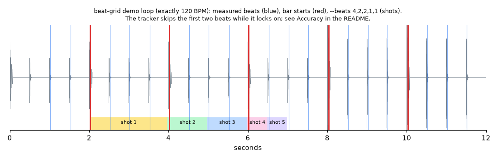

# beat-grid

Cut video on the beat. `beat-grid` measures where the beats and bar starts are in a song, makes a click track you
can line up in any video editor, and tells you exactly how long each shot should be (in whole frames) so every cut
lands on the beat.



It works from the beats it measures, not from a constant tempo, so the grid stays in step with songs whose tempo
drifts. Everything runs on your computer; nothing is uploaded.

## Install

Python 3.11 or newer. With [uv](https://docs.astral.sh/uv/) or pipx (the install is about 275 MB, mostly the
audio-analysis libraries):

```bash
uv tool install git+https://github.com/hassanitani6/beat-grid
# or: pipx install git+https://github.com/hassanitani6/beat-grid
```

## Try it

```bash
beat-grid demo                                    # -> demo.wav, a synthetic 20-second drum loop at 120 BPM
beat-grid analyze demo.wav                        # -> demo.beats.json
beat-grid click demo.beats.json                   # -> demo.click.wav
beat-grid cuts demo.beats.json --beats 4,2,2,1,1  # shot lengths
beat-grid energy demo.wav --grid demo.beats.json  # which bars are loud and busy
```

`cuts` prints something like:

```text
music starts at 2.0201 s, 30 fps, cuts 1 frame(s) early
4 beats -> 1.97 s (59 frames)
2 beats -> 1.00 s (30 frames)
2 beats -> 1.00 s (30 frames)
1 beat  -> 0.50 s (15 frames)
1 beat  -> 0.50 s (15 frames)
total 4.97 s
```

Start your first shot where the music is at 2.02 s and make each shot that many frames long. Shot lengths are whole
frames, so when a beat isn't a whole number of frames (for example half a beat at 120 BPM and 25 fps), neighbouring shots can differ by a frame; the cuts still land on the beats.

Two things in this output are worth knowing, because they happen with real songs too. The demo loop is exactly
120 BPM but is reported as 117.45: the tempo figure is measured in steps (near 120 the steps are about 117.5 and
123), while the beat times themselves follow the actual hits. And the loop's first bar starts at 0 s, but the first
beats found are at about 1 s and the first bar start at 2.02 s: the beat tracker usually skips the opening beat or
two while it locks on. Check the start with the click track, and add beats to the JSON by hand if you need them.

## Commands

| Command | What it does |
|---|---|
| `demo` | Writes `demo.wav`, a synthetic drum loop to try the other commands on. |
| `analyze SONG...` | Measures tempo, every beat and the start of every bar. Writes `SONG.beats.json` (times in seconds). |
| `click GRID` | A 48 kHz mono WAV with a short click on every beat and a louder, higher click on each bar start. Drop it on a timeline under your music to see the grid. |
| `cuts GRID --beats 4,2,2,1,1` | Lengths for shots that last that many beats each. `--offset` is where your edit starts in the song (default: the first bar start), `--fps` the video frame rate (default 30, which suits phone video; use `--fps 25` for PAL footage), `--lead` how many frames before the beat to cut (default 1; cuts read as on the beat when they land a frame early). `--json` for scripts. |
| `energy SONG` | Loudness and onset density for each block of bars (`--bars 4`), to find the intro, build and drop. |
| `doctor` | An environment report for bug reports, with your user name and home folder removed. |

Supported audio: WAV, FLAC, OGG, AIFF and MP3 work out of the box. M4A/AAC and other formats need
[ffmpeg](https://ffmpeg.org) installed. Songs up to 20 minutes (and about 120 million samples, e.g. 20 minutes of
48 kHz stereo).

### The beat grid file

```json
{"bpm": 120.0, "beats": [0.5, 1.0, 1.5], "downbeats": [0.5], "duration": 20.0}
```

You can write or fix one by hand: `beats` and `downbeats` (bar starts) are times in seconds, in order. `accents` is
accepted as another name for `downbeats`.

### Safety

- Existing files are never replaced without `--overwrite`, and an output can never replace one of its inputs.
- Every input is checked, and every output name planned, before anything is written; problems are reported as plain
  messages.
- When you analyse several songs and one can't be decoded, the others are still analysed and written; the failure is
  reported and the exit code is 1.
- Each file is written to a hidden, uniquely named `.part` file beside it and renamed when complete, so Ctrl-C or an
  error never leaves a half-written file. A hard kill (power loss, `kill -9`) can leave that `.part` file behind; it
  is safe to delete.

## Accuracy

Beat tracking uses [librosa](https://librosa.org). It is reliable on music with a clear pulse (pop, electronic,
hip-hop, rock) and less so on rubato classical or ambient music. Like any beat tracker it can lock on at half or
double the tempo you hear (for example 70 instead of 140 BPM); if the clicks come at every other beat, or twice per
beat, use `--beats` counts to match. It usually skips the first beat or two, and the BPM figure is measured in steps
of a few BPM (see the demo above). Bar starts are guessed from the low-frequency (kick drum) energy and assume four
beats to a bar; check them with the click track and edit the JSON if needed.

## Licence

MIT. See [LICENSE](LICENSE). Dependencies are installed separately and not bundled here. Most use permissive
licences (ISC, BSD, MIT, Apache-2.0); `soxr` (used by librosa for resampling) and the libsndfile library inside
`soundfile` are LGPL, and `certifi` is MPL-2.0. All are used unmodified as ordinary installed packages.
